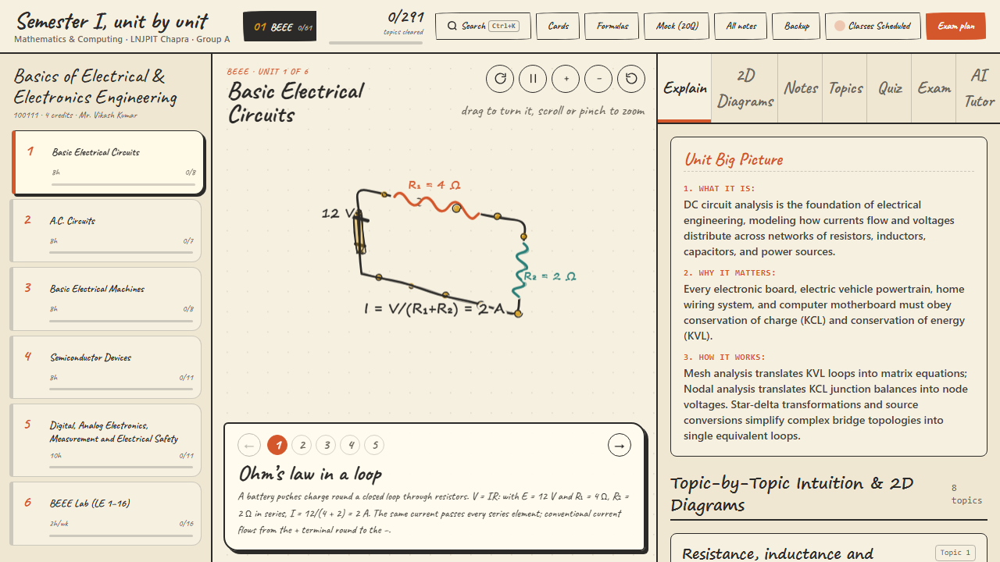

# Semester I, Unit by Unit, in 3D · LNJPIT Chapra

A visual, interactive full-stack study platform for **B.Tech Semester I** (Mathematics & Computing, Group A) at Lok Nayak Jai Prakash Institute of Technology (LNJPIT), Chapra. Built with Next.js 14 App Router, TypeScript, Tailwind CSS, Prisma/PostgreSQL, a custom 3D canvas sketch engine, KaTeX, IndexedDB local persistence, PWA support, and an academic AI doubt solver.



---

## Academic Scope & Curriculum

Covering all **8 subjects**, **43 units**, and **291 topics** (20 total credits) according to the university syllabus:

| Subject | Code | Units | Topics | Credits | Focus |
| :--- | :---: | :---: | :---: | :---: | :--- |
| **Engineering Mathematics-I** | 100102 | 5 | 40 | 3 | Matrices, Calculus, Multivariable, Integration, Vector Calculus |
| **Engineering Physics** | 100104 | 6 | 57 | 4 | Wave Optics, Lasers & Fiber, EM Waves, Quantum Mechanics, Semiconductors |
| **Basics of Electrical & Electronics Eng.** | 100111 | 6 | 61 | 4 | DC Circuits, AC Circuits, Machines, Semiconductors, Digital Electronics |
| **Introduction to AI** | 100106 | 5 | 39 | 3 | Search Algorithms, Knowledge Representation, Machine Learning, Ethics |
| **Computer Fundamentals & Emerging Tech.** | 100108 | 5 | 42 | 3 | Architecture, Operating Systems, Networking, Cloud, Security |
| **Universal Human Values** | 100107 | 5 | 18 | 2 | Self-exploration, Harmony in Human Being, Family, Society, Nature |
| **Programming for Problem Solving Lab** | 100112P | 6 | 17 | 1 | 17 C/C++ Laboratory Experiments (LE-1 to LE-17) |
| **Essence of Indian Constitution** | 100109 | 5 | 17 | 0 | Preamble, Fundamental Rights, Union & State Governance (Mandatory Audit) |

---

## Key Features

1. **Custom 3D Notebook Canvas Engine (`src/components/canvas/`)**
   - Pure HTML5 2D Canvas rendering 3D isometric and perspective wireframes using a warm paper look.
   - Interactive mouse rotation, touch drag, pinch zoom, auto-spin, and step-by-step scene progressions.
   - Real-time parameter sliders (e.g. AC impedance triangle, wave superposition, turns ratio).

2. **Hand-Drawn Paper Aesthetic**
   - Warm paper textures (`#fdfcf7`, `#f7f4ea`), charcoal ink strokes (`#2b2a28`), and terracotta accents.
   - Strictly no neon glow, no frosted glassmorphism, no gradient fills.
   - Inter font for clear technical reading; Caveat cursive font reserved for handwritten annotations.

3. **Offline-First Persistence**
   - 100% functional without an internet connection or server database.
   - Topic completion ticks, confidence levels, flashcard mastery, and unit notes saved directly to browser IndexedDB.
   - Full JSON backup export and import for seamless study migration between devices.

4. **17 C/C++ PPS Lab Experiments (`PpsCodeRunner`)**
   - Complete executable C source code for all 17 syllabus programming experiments.
   - Animated execution trace showing line-by-line pointer and variable memory changes.

5. **AI Academic Doubt Solver (`/api/tutor`)**
   - Context-aware tutor grounded in syllabus unit definitions, key mathematical steps, and university exam traps.
   - Dual-model fallback (Gemini 2.5 Flash → Flash-Lite) with client-side image compression for handwritten math OCR.
   - Automatic fallback to syllabus-grounded template answers when offline or when no API key is configured.

---

## Project Structure

```text
semester-one-nextjs/
├── prisma/
│   └── schema.prisma         # PostgreSQL schema (UserProgress, Notes, Flashcards)
├── public/
│   ├── sw.js                 # PWA Service Worker (offline shell caching)
│   └── manifest.webmanifest  # PWA configuration and mobile icons
├── scripts/
│   ├── check-data.ts         # 63 data integrity and syllabus validation tests
│   └── audit-phase0.ts       # Visual regression and viewport test harness
├── src/
│   ├── app/
│   │   ├── api/
│   │   │   ├── progress/     # Cloud sync endpoint (returns 501 when DB not configured)
│   │   │   └── tutor/        # Multi-model AI doubt solver route
│   │   ├── layout.tsx        # Root layout with Inter and Caveat Google fonts
│   │   ├── page.tsx          # Main notebook study application
│   │   ├── error.tsx         # Client error boundary
│   │   ├── not-found.tsx     # 404 handler
│   │   ├── robots.ts         # Search engine crawler policies
│   │   └── sitemap.ts        # Sitemap generation
│   ├── components/
│   │   ├── canvas/           # Custom 3D engine (NotebookCanvas3D, Builder)
│   │   └── study/            # Study panels (Header, Sidebar, Tutor, Quiz, Code Runner)
│   ├── data/
│   │   ├── subjects.ts       # All 8 subjects, syllabus breakdowns, 2D diagrams
│   │   ├── scenes.ts         # 43 interactive 3D scene builders
│   │   ├── topicContent.ts   # Definitions, formulas, and 2D SVGs for 291 topics
│   │   ├── worked.ts         # University exam worked problems
│   │   ├── quizBank.ts       # 86 unit quiz questions
│   │   └── schedule.ts       # Room 13 timetable and 6-week countdown
│   ├── lib/
│   │   ├── offlineStorage.ts # IndexedDB and JSON export/import
│   │   └── rateLimit.ts      # Token bucket rate limiter
│   └── types/
│       ├── css.d.ts          # CSS module side-effects declaration
│       └── syllabus.ts       # TypeScript interfaces for syllabus and state
└── tests/e2e/                # Playwright test suites (Desktop and Mobile)
```

---

## Getting Started

### Prerequisites
- Node.js >= 20 (`node -v`)
- npm >= 10 (`npm -v`)

### Installation & Setup
```bash
# 1. Clone the repository
git clone https://github.com/<your-username>/semester-one-nextjs.git
cd semester-one-nextjs

# 2. Install dependencies cleanly
npm ci

# 3. Generate Prisma client
npx prisma generate

# 4. (Optional) Configure environment variables
cp .env.example .env.local
# The app runs 100% locally with zero env vars.
# To enable live Gemini AI tutoring, add: GEMINI_API_KEY="your-key"

# 5. Start development server
npm run dev
```

Visit [http://localhost:3000](http://localhost:3000) in your browser.

---

## Available Scripts

| Script | Command | Purpose |
| :--- | :--- | :--- |
| `dev` | `next dev` | Start development server on port 3000 |
| `build` | `prisma generate && next build` | Generate Prisma client and compile optimized production build |
| `start` | `next start` | Run production server locally |
| `typecheck` | `tsc --noEmit` | Run TypeScript type checking with zero code emit |
| `lint` | `next lint` | Validate codebase with ESLint |
| `check:data` | `tsx scripts/check-data.ts` | Assert syllabus integrity, SVG schema, and data completeness |
| `test:e2e` | `playwright test` | Run Playwright test suite (Desktop Chrome + Mobile 390px) |

---

## How to Add a New Unit

To add or expand a syllabus unit:
1. **Define Unit Metadata in `src/data/subjects.ts`:**
   Add unit title (`t`), estimated lecture hours (`h`), topic checklist strings (`topics`), conceptual summary (`s`), and exam key moves (`k`).
2. **Build the 3D Scene in `src/data/scenes.ts`:**
   Create `SC['<subjectId>:<unitIndex>']` using `Builder` primitives (`L`, `A`, `T`, `C`, `P`) in coordinate range `[-7, 7]`.
3. **Add Topic Definitions & 2D Diagrams in `src/data/topicContent.ts`:**
   Provide a 1-line definition, boxed formula, exam marking scheme, and valid SVG diagram for each topic.
4. **Add Quiz Questions in `src/data/quizBank.ts`:**
   Add at least 2 multiple-choice questions for the unit.
5. **Add Worked Numerical in `src/data/worked.ts`:**
   Provide a university exam numerical with step-by-step LaTeX solution.
6. **Verify Data Integrity:**
   Run `npm run check:data` to ensure all 63 integrity assertions pass.

---

## Deployment to Vercel

The application is optimized for zero-configuration deployment to Vercel:

1. Push your repository to GitHub.
2. In the Vercel Dashboard, select **Add New Project** and import the repository.
3. Keep default build settings (`Framework: Next.js`, `Node.js: 20.x`).
4. (Optional) Set `GEMINI_API_KEY` in **Environment Variables** if you wish to enable live AI responses.
5. Click **Deploy**.

---

## Privacy Note

**Your study data remains entirely in your browser.**
Topic progress, test scores, flashcard ratings, and custom notes are stored in local IndexedDB. No personal identity, student records, or browsing activity are transmitted to external servers.

---

## Disclaimer

> [!WARNING]
> This platform is an independent student study aid created for LNJPIT Chapra B.Tech Semester I students. **It is not an official university publication.** Always verify formulas, derivations, exam regulations, and syllabus requirements with your course professors and departmental notices.
