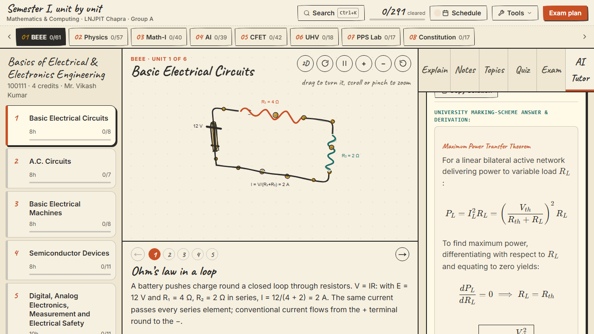
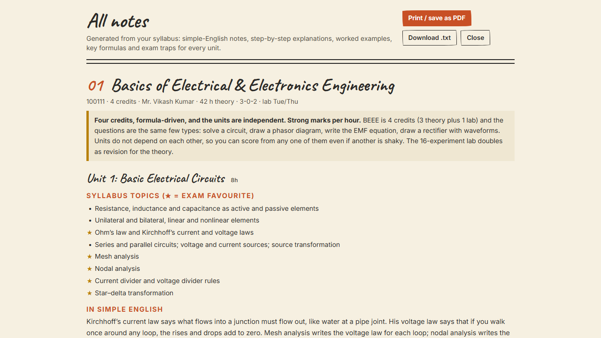
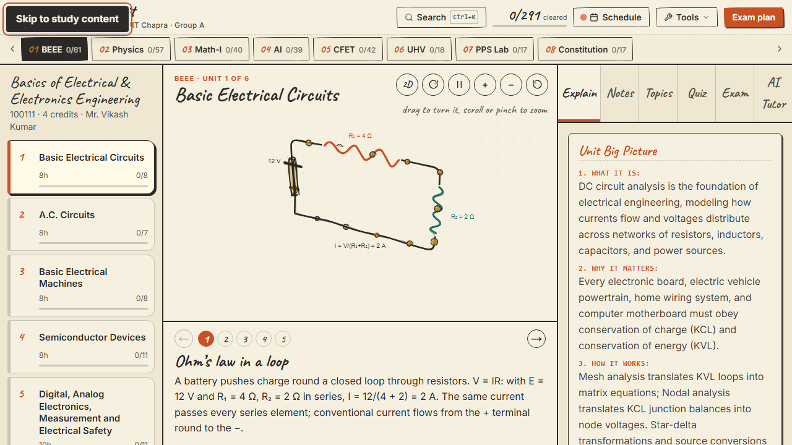
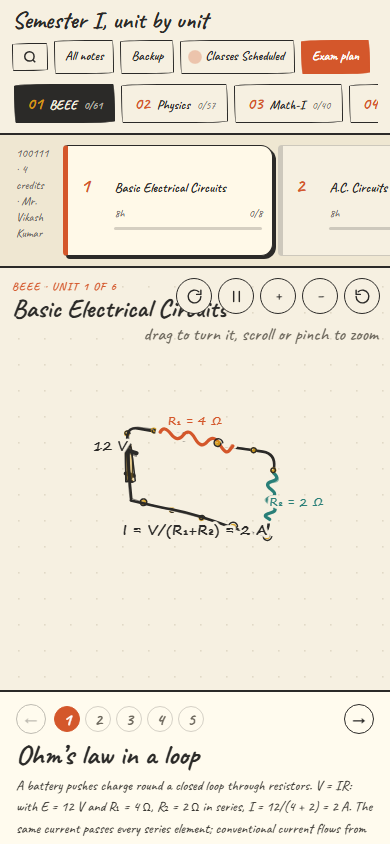

<div align="center">

# 📐 Semester I, Unit by Unit, in 3D
### Interactive Study Platform for B.Tech Mathematics & Computing (Group A)
**Lok Nayak Jai Prakash Institute of Technology (LNJPIT), Chapra**

[](https://the-first-semester.vercel.app)
[](https://nextjs.org/)
[](https://www.typescriptlang.org/)
[](https://tailwindcss.com/)
[](https://playwright.dev/)
[](https://katex.org/)
[](https://web.dev/progressive-web-apps/)
[](LICENSE)

<br />

### 🌐 Live Production Website: [https://the-first-semester.vercel.app](https://the-first-semester.vercel.app)

**A full-stack, offline-first study companion presenting the entire 20-credit B.Tech Semester I curriculum in hand-drawn 3D wireframes, interactive mathematical visualizers, step-by-step derivations, worked numerical problems, and a multimodal AI doubt tutor.**

</div>

---

## 📸 Visual Showcase

<div align="center">
  
</div>

<br />

<table align="center" width="100%">
  <tr>
    <td width="50%" align="center">
      <b>Multimodal AI Tutor & KaTeX Math Solver</b><br /><br />
      
    </td>
    <td width="50%" align="center">
      <b>All Notes & PDF Export Handbook</b><br /><br />
      
    </td>
  </tr>
  <tr>
    <td width="50%" align="center">
      <b>Accessible Keyboard Skip-to-Content Navigation</b><br /><br />
      
    </td>
    <td width="50%" align="center">
      <b>Responsive 390px Mobile Smartphone Viewport</b><br /><br />
      
    </td>
  </tr>
</table>

---

## 🎓 Academic Curriculum Matrix (100% Coverage)

Every unit adheres strictly to the official AKU Patna / LNJPIT Chapra B.Tech First-Year syllabus, with complete definitions, formulas, 2D diagrams, 3D scenes, step-by-step derivations, and exam model numericals:

| # | Subject | Code | Units | Topics | Credits | Key Academic Domains Covered | Worked Numericals |
| :-: | :--- | :---: | :---: | :---: | :---: | :--- | :---: |
| **01** | **Basics of Electrical & Electronics Eng.** | `100111` | 6 | 61 | 4.0 | DC Circuits, Theorems, AC Power Triangles, Transformers, Diodes & BJTs, Digital Gates | **6 / 6 (100%)** |
| **02** | **Engineering Physics** | `100104` | 6 | 57 | 4.0 | Wave Optics (Interference & Diffraction), Lasers & Fibers, EM Waves, Quantum Mechanics, Semiconductors | **6 / 6 (100%)** |
| **03** | **Engineering Mathematics-I** | `100102` | 5 | 40 | 3.0 | Matrices & Rank, Cayley-Hamilton, Mean Value Theorems, Multivariable Calculus, Beta-Gamma Integrals, Green's & Stokes' | **5 / 5 (100%)** |
| **04** | **Introduction to AI** | `100106` | 5 | 39 | 3.0 | PEAS Agents, Uninformed & Heuristic Search (A*), Knowledge Representation, Machine Learning, AI Ethics | **5 / 5 (100%)** |
| **05** | **Computer Fundamentals & Emerging Tech.** | `100108` | 5 | 42 | 3.0 | CPU & Memory Hierarchies, Operating Systems, TCP/IP Networking, Cloud Computing, Cybersecurity | **5 / 5 (100%)** |
| **06** | **Universal Human Values** | `100107` | 5 | 18 | 2.0 | Self-Exploration, Harmony in Self, Trust & Respect in Relationships, Harmony in Society, Natural Co-existence | **5 / 5 (100%)** |
| **07** | **Programming for Problem Solving Lab** | `100112P`| 6 | 17 | 1.0 | 17 C/C++ Laboratory Experiments (LE-1 to LE-17) with interactive step execution | **6 / 6 (100%)** |
| **08** | **Essence of Indian Constitution** | `100109` | 5 | 17 | 0.0 | Preamble, Fundamental Rights & Duties, Directive Principles, Parliamentary Governance (Mandatory Audit) | **5 / 5 (100%)** |
| **Σ** | **Total Curriculum Overview** | **—** | **43 Units** | **291 Topics** | **20 Credits** | **Full First-Semester LNJPIT Engineering Foundation** | **43 / 43 (100%)** |

---

## ⚡ Core Engineering & Architecture

### 1. Custom 3D Isometric Notebook Canvas (`src/components/canvas/`)
- Pure HTML5 2D Canvas engine projecting 3D vectors via trigonometric matrix transformations without heavy WebGL dependencies.
- Bounded coordinate space (`-7` to `+7` range) guaranteeing zero element collisions.
- Smooth mouse drag rotation, pinch-to-zoom, auto-spin, and step-by-step interactive demonstrations.

### 2. Hand-Drawn Paper Notebook Aesthetic
- Natural paper background (`#fdfcf7`, `#f7f4ea`), crisp charcoal ink (`#2b2a28`), terracotta accents (`#c85025`), and warm gold cues.
- **Inter** body typography for technical legibility and **Caveat** cursive display font for handwritten notebook annotations.
- Zero generic neon colors or intrusive glassmorphism. Fully WCAG 2.1 AA compliant with contrast ratios $\ge 5.5:1$.

### 3. Multimodal AI Doubt Tutor (`/api/tutor`)
- Serverless API route using Gemini 2.5 Flash with Flash-Lite fallback.
- Client-side math OCR: Upload or snap handwritten problems from textbooks/paper with automatic image compression.
- Safe KaTeX rendering engine (`SafeMarkdownText`) supporting both display math (`$$...$$`) and inline math (`$...$`) without raw markup leakages or XSS vulnerabilities.
- Graceful offline fallback: Displays offline syllabus-grounded solutions with university marking schemes during rate limits (15 req/min) or network disconnections.

### 4. 100% Local-First Offline Storage (`src/lib/offlineStorage.ts`)
- Complete persistence via browser **IndexedDB** (`idb` v8).
- Tracks topic mastery checkboxes, confidence ratings, custom student notes, and SM-2 flashcard review intervals without requiring server login.
- Built-in JSON export and import hub for single-click data backups across devices.

### 5. 17 C/C++ Programming Lab Experiments (`PpsCodeRunner.tsx`)
- Contains full compilable source code for all 17 syllabus programming experiments (LE-1 to LE-17).
- Interactive step-by-step animated execution trace showing memory addresses, pointers, and console outputs.

### 6. Accessibility & Keyboard Navigation (WCAG AA)
- Standardized `useModalA11y` focus trap across all 8 modal dialogues with global `Escape` key dismissal.
- High-contrast `Skip to study content` link for screen reader and keyboard accessibility.

---

## 🚀 Getting Started

### Prerequisites
- **Node.js** >= 20.x (`node -v`)
- **npm** >= 10.x (`npm -v`)
- Modern web browser (Chrome, Edge, Firefox, Safari)

### Installation & Local Setup

```bash
# 1. Clone the repository
git clone https://github.com/Mr-AnshuSingh/TheFirstSemester.git
cd TheFirstSemester

# 2. Install dependencies cleanly
npm ci

# 3. Generate the Prisma Client
npx prisma generate

# 4. (Optional) Setup environment variables
cp .env.example .env.local
# The app is 100% functional locally with zero environment variables!
# To enable live AI cloud tutoring, add: GEMINI_API_KEY="your-google-ai-studio-key"

# 5. Start the Next.js development server
npm run dev
```

Open [http://localhost:3000](http://localhost:3000) to view the notebook study platform.

---

## 🧪 Testing & Quality Gates

This repository enforces strict CI/CD quality gates across data completeness, static typing, code style, and end-to-end user workflows:

```bash
# Verify syllabus completeness & 43-unit data integrity (64 assertions)
npm run check:data

# TypeScript static typecheck (zero code emit)
npm run typecheck

# Code quality and styling linting
npm run lint

# Compile optimized Next.js App Router production build
npm run build

# Execute full Playwright E2E test suite (20 tests on Chromium Desktop & Mobile 390px)
npm run test:e2e
```

### Playwright E2E Test Suite Matrix (20/20 Passing)
- `tests/e2e/accessibility.spec.ts`: Skip link, tab accessibility, focus trap, and Escape key dismissal.
- `tests/e2e/ai-tutor.spec.ts`: KaTeX display math, rate-limiting banner, and offline fallback degradation.
- `tests/e2e/worked-examples.spec.ts`: Tab 0 numericals and 43/43 worked handbook coverage (`.we` count).
- `tests/e2e/backup-roundtrip.spec.ts`: IndexedDB state export/import and malformed JSON rejection.
- `tests/e2e/mobile-390px.spec.ts`: Zero horizontal scrollbar and responsive diagram scaling on iPhone 390px.
- `tests/e2e/quiz.spec.ts`: Unit quiz questions, radio button selection, and automated scoring.
- `tests/e2e/topic-persistence.spec.ts`: Checkbox toggle debouncing and IndexedDB reload persistence.
- `tests/e2e/units-and-steps.spec.ts`: 8-subject switching and 3D scene step cycling.

---

## 🛠️ GitHub Actions CI/CD

- **`.github/workflows/ci.yml`**: Triggered on every push and pull request to `main`. Executes `npm ci`, data assertions, typechecking, linting, production build, and headless Playwright tests with test report artifact uploads.
- **`.github/workflows/production-readiness.yml`**: Scheduled weekly audit (Mondays 04:00 UTC) with high-severity vulnerability scanning (`npm audit`) and full test regressions.
- **`.github/dependabot.yml`**: Automated weekly dependency version updates for npm packages and GitHub Actions.

---

## ☁️ Deployment to Vercel

The application is optimized for instantaneous deployment on [Vercel](https://vercel.com):

1. Fork or push this repository to your GitHub account.
2. In the Vercel dashboard, click **Add New Project** and select this repository.
3. Keep default settings (`Framework: Next.js`, `Node.js: 20.x`).
4. (Optional) Add `GEMINI_API_KEY` under **Environment Variables** if live AI tutoring is desired.
5. Click **Deploy**.

---

## 📄 Privacy & Data Ownership

- **100% Client-Side Ownership:** All study progress, quiz scores, flashcards, and notes remain on your device in IndexedDB.
- **Zero Tracking:** No analytics tracking, telemetry, or student personal identifiers are stored or shared.

---

## ⚖️ License & Disclaimer

Distributed under the **MIT License**. See [`LICENSE`](LICENSE) for details.

> [!NOTE]  
> *This platform is an independent student study aid created for LNJPIT Chapra B.Tech Semester I students. It is not an official university publication. Always verify formulas, derivations, and exam guidelines with your course professors and departmental notifications.*

<br />

<div align="center">
  <b>Engineered with ❤️ for B.Tech Mathematics & Computing (2026–2030) · LNJPIT Chapra</b><br />
  Maintained by <a href="https://github.com/Mr-AnshuSingh">Mr-AnshuSingh</a>
</div>
